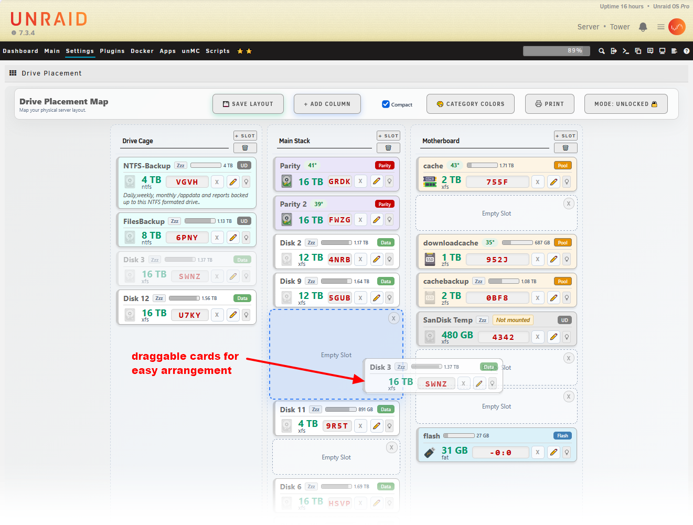
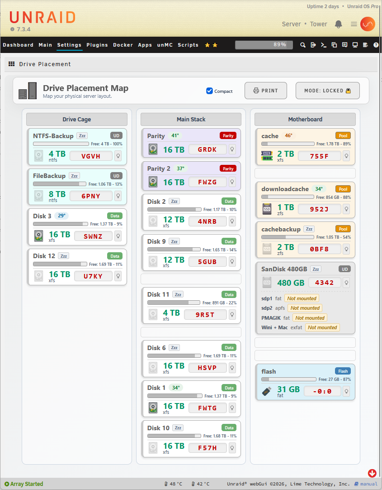
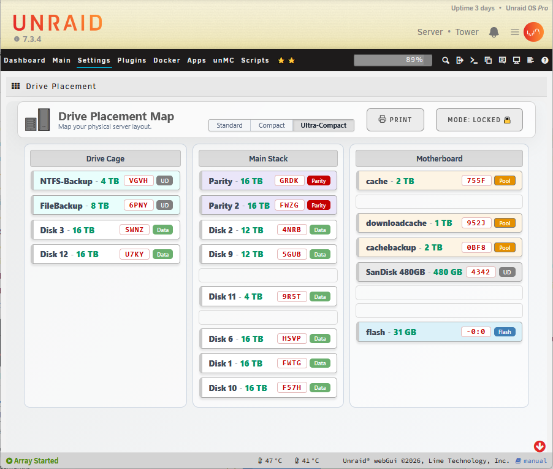
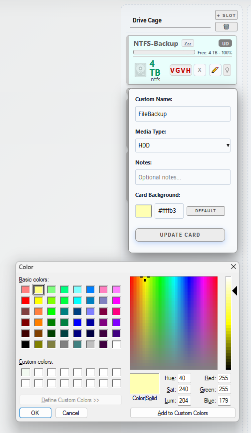
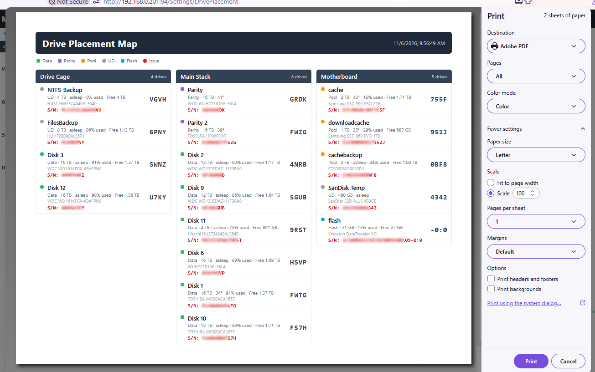

# Drive Placement for unRAID

**Drive Placement** is an interactive, drag-and-drop visualizer that maps your physical unRAID server layout to a virtual dashboard. When a drive fails, you'll know exactly which bay to pull - never guess which physical slot "Disk 5" lives in again.

**Setup takes about a minute.** There's nothing to configure - your drives show up automatically, you just **drag them into columns** that match your case and hit Save. No tray definitions, no per-slot forms, no fiddly wizard.

Create with assistance of Claude AI.

<p align="center">
  <a href="https://www.buymeacoffee.com/hernandito" target="_blank">
    
  </a>
</p>


**Standard View**

## Features

### Layout
* **Visual drag and drop** - move active drives from the Unplaced Pool into custom columns that represent your physical drive cages, stacks, or the motherboard.
* **Per-column auto-width** - each column sizes itself to its widest card, independently of the others.
* **Locked / Unlocked modes** - lock the dashboard to prevent accidental changes. Empty slots stay visible when locked, so the air-gaps in your case are represented accurately.
* **Compact mode** - a slim single-line card view for dense layouts.


**Unlocked Mode**

### Drive cards
* **At-a-glance status** - each card shows the drive's temperature (color-coded pill), usage bar, free space, size, filesystem format, media type, and the last four of the serial number.
* **Filesystem format** - a small label under the size shows the filesystem (xfs, btrfs, zfs, ntfs, fat, exfat ...).
* **Unassigned device support** - UD drives get the same temperature, usage, and free-space readout as array and pool drives. A device that isn't mounted is clearly flagged **Not mounted** in place of the usage bar.
* **Multi-partition drives** - a UD drive with more than one partition lists each partition below the card (name, format, and usage, or "Not mounted"), so a multi-partition external or backup drive reads clearly.
* **Identify a drive** - a small lightbulb button blinks the drive's own activity LED (a brief, read-only access burst), so you can spot the exact physical drive in the bay.
* **Health highlighting** - a drive with an issue (error, disabled, or failed) is highlighted with a red card, overriding any assigned color.
* **Spun-down indicator** - drives that are asleep show a "Zzz" marker and a dimmed icon.
* **Categories** - Array (Data), Parity, Pool (cache), Unassigned (UD), and Flash each get their own badge.

> **Why only the last 4 of the serial?** The large red characters on each card are the **last four of the drive's serial number** - the same short tag you can physically write on the drive, so what you see on the dashboard matches the label on the drive in the bay. When a drive fails, you match those four characters and you know exactly which one to pull. Need the full brand, model, and complete serial? Turn **off Compact mode** and they're shown on every card.


**Compact View**


**Ultra-Compact View**

### Appearance
* **Category background colors** - assign a background color to each category (Array, Parity, Pool, UD, Flash) from the color modal, with sensible default tints shipped out of the box.
* **Per-card color override** - give any individual drive its own background color from the edit panel.
* **Dark-skin aware** - the dashboard automatically matches unRAID's black/gray themes, with a tuned dark palette for cards, columns, and the color modal.


**Edit Drive**

### Other
* **Custom naming and media types** - click the pencil on any drive to set a custom name and media type (HDD, SATA SSD, NVMe, USB).
* **Per-drive notes** - add notes that appear as a tooltip in compact mode.
* **Print / PDF report** - generate a clean, printable report of your layout (letter/A4, auto portrait or landscape) with the **Print** button.
* **Persistent layouts** - everything is saved to your flash drive (`/boot/config/plugins/driveplacement/layout.json`), surviving reboots and plugin updates.


**Print Layout**

## How is this different from "Disk Location"?

The excellent [Disk Location](https://forums.unraid.net/topic/77302-plugin-disk-location/) plugin by olehj is powerful and deeply feature-rich. **Drive Placement takes a different tack: dead-simple setup and a clean, easy-to-read design.**

* **Set up in under a minute** - no tray/row/column configuration, no per-slot forms. Your drives appear in an Unplaced pool; just **drag them into columns** that match your physical cages, stacks, or motherboard, and click Save. That's the whole setup.
* **Built to be read at a glance** - each card shows just the right amount: temperature, usage, free space, filesystem, and the last-four serial you actually label your drives with - nothing to decode.
* **Looks at home in unRAID** - automatically matches your light or dark skin.

If you want maximum configurability and every possible option, Disk Location is a great choice. If you want a drive map that takes a minute to set up and is effortless to read, that's exactly what Drive Placement is for.

## Installation

Go to the **Plugins** tab in your unRAID GUI, select **Install Plugin**, and paste:

```
https://raw.githubusercontent.com/hernandito/Drive.Placement/main/driveplacement.plg
```

The dashboard appears under **Settings → Utilities → Drive Placement**.

## Support

Issues and requests: [github.com/hernandito/Drive.Placement](https://github.com/hernandito/Drive.Placement)
