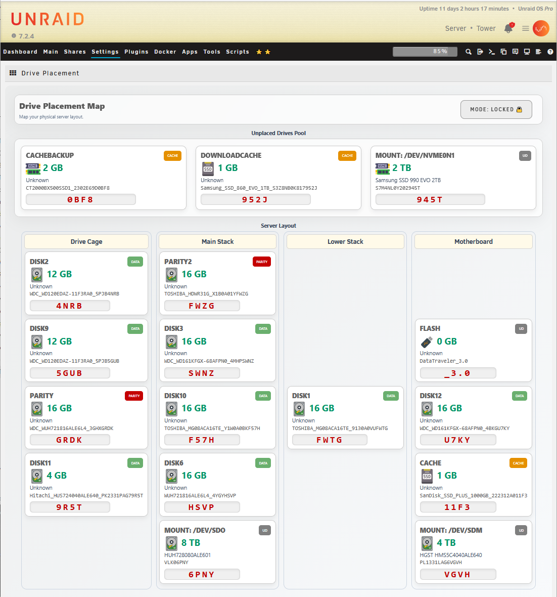

# Drive Placement Map for unRAID

Drive Placement is an interactive, drag-and-drop visualizer that allows you to map your physical unRAID server layout to a virtual dashboard. Never forget which physical slot "Disk 5" lives in again!

## Features
* **Visual Drag & Drop:** Easily move your active unRAID drives from the Unplaced Pool into custom columns (e.g., "Drive Cage", "Main Stack").
* **Custom Naming & Media Types:** Click the pencil icon on any drive to give it a custom name and assign its physical media type (Spinner, SATA SSD, NVMe, USB).
* **Locked/Unlocked Modes:** Lock the dashboard to prevent accidental changes. Empty slots remain visible in locked mode to accurately represent the physical air-gaps in your server case.
* **Persistent Layouts:** Your layout is safely saved to your flash drive (`/boot/config/plugins/driveplacement/layout.json`) so it survives reboots and plugin updates.

## Installation
Go to the **Plugins** tab in your unRAID GUI, select **Install Plugin**, and paste the following URL:

`https://raw.githubusercontent.com/hernandito/Drive.Placement/main/driveplacement.plg`